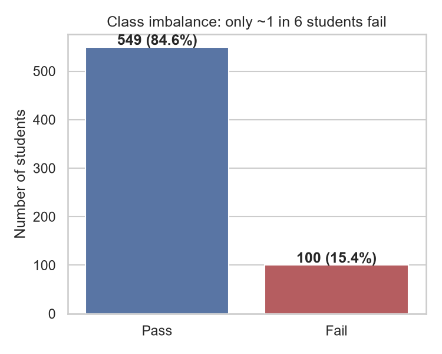
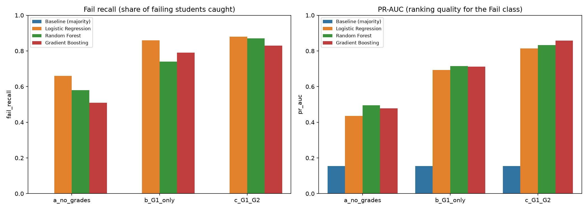
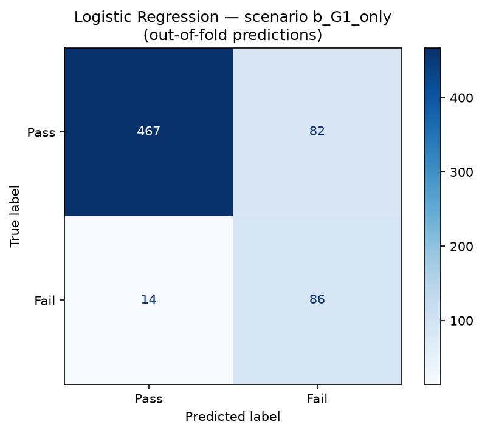
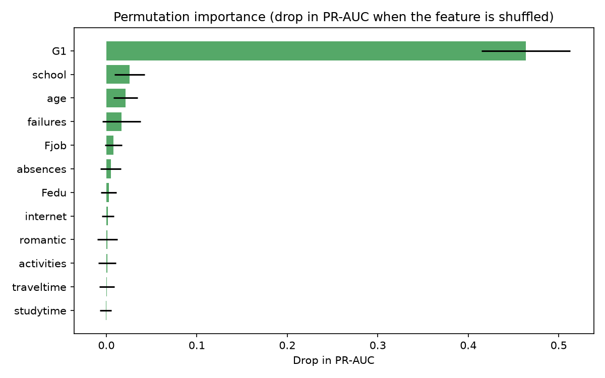
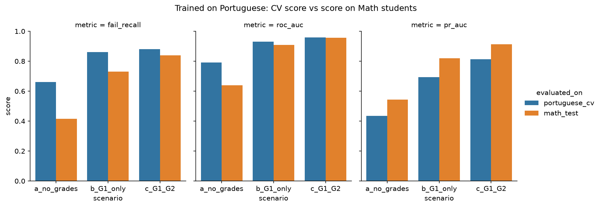

# 🎓 Student Early-Warning System

**Predicting which students are likely to fail, early enough to help them.**

[**▶ Live demo**](https://student-early-warning.streamlit.app) · Python · scikit-learn · Streamlit · SHAP


---

## The problem

Teachers usually find out a student is failing when the final grade arrives, which is too late to help. This project builds an **early-warning system** that flags at-risk students **after the first grading period**, while there is still time to intervene (extra classes, tutoring, a talk with parents).

The target is binary: **fail = final grade G3 < 10** (on a 0–20 scale).

## The honest story: accuracy was misleading

This started as a course assignment that used 5 features and reported **~92% accuracy**. Looking closer showed three problems:

1. **Class imbalance.** Only 100 of 649 students fail (15.4%). A "model" that always predicts *Pass* already gets **84.6% accuracy** while catching **0%** of failing students.
2. **Leakage of late information.** The second-period grade G2 correlates **0.92** with the final grade. A single rule, *"G2 < 10 → Fail"*, catches **89%** of failing students with no machine learning at all. But G2 arrives near the end of the year, too late to act on.
3. **27 of 32 features were dropped without being tested.**

So version 2 asks a better question: **how well can we predict failure *before* the late grades exist?** It is evaluated with metrics that focus on the students who fail (recall, F1, PR-AUC), not accuracy.



## Dataset

[UCI Student Performance](https://archive.ics.uci.edu/dataset/320/student+performance) (Cortez & Silva, 2008), licensed CC BY 4.0.

- **Training:** Portuguese course, 649 students, 30 background features (school, family, study habits, past failures, ...) plus grades G1, G2, G3.
- **Generalization test:** Math course, 395 students.

## Approach

| Step | What was done |
|---|---|
| **EDA** | Class imbalance, distributions, fail rate per category for all 30 features, grade correlations ([notebook](notebooks/01_eda.ipynb)) |
| **Preprocessing** | scikit-learn `Pipeline` + `ColumnTransformer`: one-hot encoding for categoricals, scaling for numerics, fitted **inside** each CV fold to prevent leakage ([`src/preprocessing.py`](src/preprocessing.py)) |
| **3 scenarios** | (a) no grades: start of year · (b) G1 only: after period 1 · (c) G1 + G2: after period 2 |
| **4 models** | Majority baseline, Logistic Regression, Random Forest, Gradient Boosting, all with `class_weight="balanced"` |
| **Evaluation** | Stratified 5-fold CV with **nested** light hyperparameter tuning (inner 3-fold, tuned on PR-AUC) ([`src/evaluate.py`](src/evaluate.py)) |
| **Explainability** | Coefficients, permutation importance on held-out folds, SHAP ([notebook](notebooks/03_explainability.ipynb)) |
| **Generalization** | Trained on Portuguese, tested on Math ([notebook](notebooks/04_generalization.ipynb)) |
| **App** | Streamlit app: fail-risk score, Low / Medium / High band, top 3 reasons ([`app/streamlit_app.py`](app/streamlit_app.py)) |

All randomness uses `random_state=42`. Every number in this README is computed in the notebooks, not typed by hand.

## Results

Stratified 5-fold cross-validation, Portuguese dataset (mean over folds; all metrics are for the **Fail** class):

| Scenario | Model | Recall | Precision | F1 | ROC-AUC | PR-AUC |
|---|---|---|---|---|---|---|
| **(a) no grades** | Baseline (always Pass) | 0.00 | 0.00 | 0.00 | 0.50 | 0.15 |
| | Logistic Regression | **0.66** | 0.35 | 0.46 | 0.79 | 0.44 |
| | Random Forest | 0.58 | 0.39 | 0.46 | **0.83** | **0.50** |
| | Gradient Boosting | 0.51 | 0.40 | 0.44 | 0.79 | 0.48 |
| **(b) G1 only** | Logistic Regression | **0.86** | 0.51 | 0.64 | 0.93 | 0.69 |
| | Random Forest | 0.74 | 0.64 | **0.68** | **0.94** | **0.72** |
| | Gradient Boosting | 0.79 | 0.59 | 0.66 | 0.94 | 0.71 |
| **(c) G1 + G2** | Logistic Regression | 0.88 | 0.59 | 0.71 | 0.96 | 0.81 |
| | Random Forest | 0.87 | 0.64 | 0.73 | 0.97 | 0.83 |
| | Gradient Boosting | 0.83 | 0.62 | 0.70 | 0.96 | **0.86** |



### Deployed model: Logistic Regression, scenario (b)

- **Early enough to act:** G1 is known after the first period.
- **Highest fail recall (0.86):** it catches 86 of 100 failing students. The trade-off is more false alarms (precision 0.51), which is acceptable here: an unnecessary check-in costs little, a missed student costs a lot.
- **Statistically tied with the tree models:** the PR-AUC differences (0.69 vs 0.72) are smaller than the fold-to-fold standard deviation (~0.07).
- **Explainable and lightweight:** one coefficient per feature, and the model file is about 100 KB.



### Risk bands in the app

Class weighting deliberately inflates the model's scores, so the app shows a **risk band** together with the fail rate actually observed in that band on unseen students (out-of-fold):

| Band | Score | Students | Actually failed |
|---|---|---|---|
| 🟢 Low | < 0.30 | 433 | 1.6% |
| 🟠 Medium | 0.30 – 0.60 | 80 | 19% |
| 🔴 High | ≥ 0.60 | 136 | 57% |

## Key findings

1. **Accuracy hides what matters.** The always-Pass baseline scores 84.6% accuracy and 0% fail recall.
2. **There is real signal without any grades.** Background features alone reach 0.66 fail recall and 3× the baseline PR-AUC. That is useful for start-of-year screening, but weaker than grade-based models.
3. **One early grade is worth more than all 30 background features.** Adding G1 lifts PR-AUC from ~0.45 to ~0.70. G2 adds little more and arrives too late.
4. **What drives risk (beyond G1):** past class failures, attending school MS, and not planning higher education. Shuffling G1 drops PR-AUC by ~0.46; every other feature by less than 0.03.
5. **Coefficients can mislead.** Father's job had large coefficients but near-zero permutation importance, because each category has only ~40 students.
6. **Grades transfer across subjects; background features don't** (see below).



### Generalization: trained on Portuguese, tested on Math

The Math data differs: its fail rate is 32.9% vs 15.4%, and 9.6% of Math students have a final grade of 0 (vs 2.3%).

| Scenario | ROC-AUC, Portuguese (CV) | ROC-AUC, Math | Change |
|---|---|---|---|
| (a) no grades | 0.79 | 0.64 | **−0.15** |
| (b) G1 only | 0.93 | 0.91 | −0.02 |
| (c) G1 + G2 | 0.96 | 0.96 | 0.00 |

- The **no-grades model does not transfer** to a new subject. The grade-based models do.
- Fail recall for (b) dropped from 0.86 to 0.73. The ranking is still good, but the model learned a 15% fail rate, so its scores are too low for Math. **Recalibrating the threshold or retraining** on the new subject would be needed before using it there.
- Precision and PR-AUC *rose* on Math, but mainly because Math has more failing students, not because the model improved.
- Caveat: according to the dataset documentation, ~382 students appear in both files, so this tests a **new subject** more than new students.



## Project structure

```
student-early-warning/
├── app/
│   ├── streamlit_app.py      # the web app
│   └── requirements.txt      # minimal, pinned deps for deployment
├── data/raw/                 # original UCI CSVs (never modified)
├── models/final_model.joblib # pipeline + reference data + risk bands
├── notebooks/
│   ├── 01_eda.ipynb
│   ├── 02_modeling.ipynb
│   ├── 03_explainability.ipynb
│   └── 04_generalization.ipynb
├── reports/
│   ├── figures/              # all charts used in this README
│   └── cv_results.csv
├── src/                      # reusable code, imported by notebooks and the app
│   ├── config.py             # paths, random_state, scenarios
│   ├── data.py               # loading, target, leakage-safe feature selection
│   ├── preprocessing.py      # Pipeline + ColumnTransformer
│   ├── models.py             # models + tuning grids
│   ├── evaluate.py           # nested stratified CV, metrics
│   ├── explain.py            # coefficients, permutation importance, per-student reasons
│   └── train_final.py        # trains and saves the deployed model
└── requirements.txt
```

## How to run

```bash
git clone https://github.com/abdullahqureshi6687-dotcom/student-early-warning.git
cd student-early-warning
python -m venv .venv
# Windows: .venv\Scripts\activate      macOS/Linux: source .venv/bin/activate
pip install -r requirements.txt

python -m src.train_final               # train + save models/final_model.joblib
streamlit run app/streamlit_app.py      # open http://localhost:8501
```

The notebooks in `notebooks/` reproduce every table and chart (run them in order).

## Limitations

- **Small, specific data:** 649 students from two Portuguese schools in 2005–2006. Results may not hold elsewhere.
- **Needs G1:** the deployed model works after the first grading period, not on day one.
- **Scores are not calibrated probabilities:** class weighting inflates them, so use the risk band and its observed fail rate.
- **Associations, not causes:** "students at school MS fail more often" does not mean the school causes failure.
- **Fairness:** features like sex, address and family background can encode bias. The tool should guide *who to check in with*, never label or penalise a student.

## Future work

- Calibrate probabilities (`CalibratedClassifierCV`) and let schools choose the decision threshold.
- Recalibrate or retrain per subject, as the Math test showed this is needed.
- Fairness audit: compare recall across sex, address and school.
- Treat students with G3 = 0 (likely dropouts) as a separate outcome.

## Author

**Abdullah Qureshi**, BS Artificial Intelligence, Air University
[GitHub](https://github.com/abdullahqureshi6687-dotcom) · [LinkedIn](https://www.linkedin.com/in/abdullah-qureshi-85a031393/)